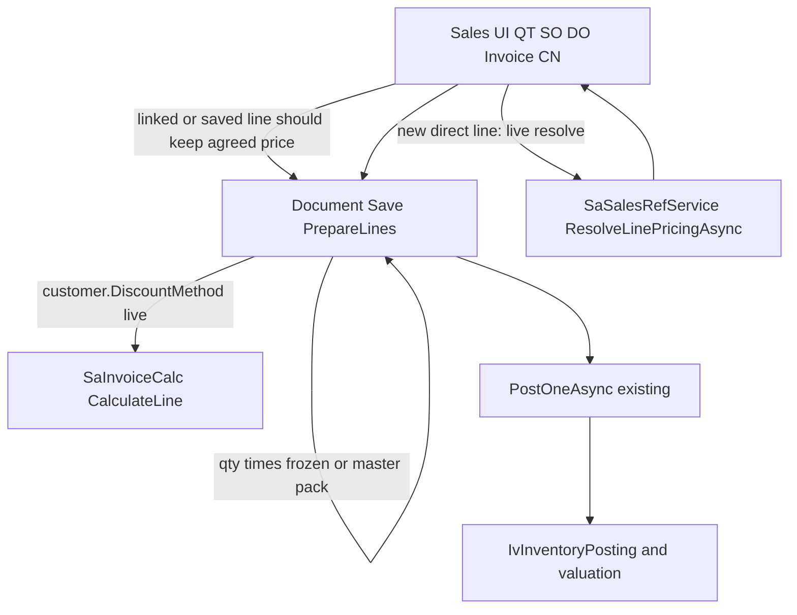

# Sales Pricing Flow — Gate 0 baseline evidence

**Status:** **PASS** (commercial investigation and Phase A confinement).  
**Physical SQL Server isolation:** **UNVERIFIED**.  
**G1–G5 / Phase B:** **NOT STARTED** — still blocked until independent review of this artifact.  
**Reviewer model:** Cursor Grok 4.6, substituting for the plan’s named “GPT-6 High”. Substitution does not waive gates.

**Pinned SHA:** `584411e317ac6990ed8a5f0886207779d821deaf` (`origin/productionv2`)  
**Inspected in:** git worktree `C:\wincom\productionv2-g0-sales-pricing` (detached, clean).  
**Operator checkout:** `c:\wincom\productionv2` at `e24f54069316a346171fed7f14017c09d593cb95`, 14 commits behind origin. Sales production code between those commits is unchanged; extra tests exist only on `584411e`.  
**Date:** 10 November 2026  
**Class:** B costing-adjacent. No code, schema, posting, rollback, quantity, CostLayer/FIFO/WAC, or WIP edits were made.

`OpenPeriodBackdatedReplayEnabled` remains a test-only inventory replay switch. Sales pricing has no rollout flag. `Company.SalesPriceMethod` is the live pricing-mode column.

---

## 1. Gate decision

| Question | Result |
|---|---|
| Can Phase A stay inside commercial price/discount/tax-basis/UOM-lookup inputs? | **Yes.** Server `PrepareLines` owns `StdQty = qty × pack`. UI unit price does not compute stock. |
| Are v2.1 findings R01–R14 present on `584411e`? | **Yes**, with the R03 narrowing in [G3 amendments](productionv2_sales_pricing_G3_GATE_AMENDMENTS.md). |
| Sqlite Sales + valuation baseline recorded? | **Yes.** See §7. |
| Isolated SQL Server scratch (`SqlServerTestConnection`)? | **UNVERIFIED** — unset. Some tests used `DefaultConnection` (`.\SQLEXPRESS` / `ERPWeb`) and failed on missing DEMO seed. That is not a certified lock/session baseline. |
| Tax-rate-on-document-date policy signed by business owner? | **Not obtained.** Keep current tax lookup. Copy tax group + inclusive flag only. |
| Phase B (DiscountMethod snapshot, CN amount2, strict override, historic tax)? | **Not authorized.** |

**G0 PASS** means only: current behavior is mapped, Phase A is confinable, and G1 may be *proposed* after independent review. It is not implementation approval and not 10/10.

---

## 2. Data flow (keep this engine)



Commercial context: `UnitPrice`, discount slots, `IsInclusive`, `TaxGrCode`/`TaxGroup`, `OrderType`, selling UOM, currency, provenance.  
Physical/cost context: `Qty`/`StdQty`/`StdPsize`, warehouse/lot, `SoConsumedQty`, `CostPrice`, `IvBalLoc`, `StockFifoLayer`, `IvTrxBatch`, WIP. Do not mix them.

**Stock owner:** DO issues `SalesOut`. A `LinkDo` invoice bills only. A direct invoice issues its own `SalesOut`. CN `ReturnStock=true` receipts `CustomerReturn` using `CostPrice` on the batch stamp; valuation uses original outbound facts. QT/SO never post stock.

There is no type named `CostLayer` on this SHA. Live tables are `StockFifoLayer`, `StockFifoLayerConsumption`, `StockCostState`, `StockValuationFact`, `SalesReturnCostAllocation`.

---

## 3. Commercial field matrix (defects that G1+ must not over-claim)

Legend: **P** present and mapped. **H** header only. **M** missing. **X** present on source, dropped by this mapper.

| Field | QT/SO line | DO entity | DO billable DTO | Invoice FromDeliveryOrder | CN CopyFromInvoice | CN entity |
|---|---|---|---|---|---|---|
| UnitPrice | P | P | P | P | P | P |
| ItemDiscount–6 | P | P | **M** | **M** | P | P (`ItemDiscount1` is the amount slot) |
| ItemDiscAmount | P | P | **M** | **M** | P | stored in `ItemDiscount1` |
| ItemDiscAmount1 | P | P | **M** | **M** | **M** | **M** |
| IsInclusive | P | P | **M** | **M** | P | P |
| Tax group | P | `TaxGroup` | **M** | **M** | P | `TaxGroup` |
| OrderType | P | P | **M** | **M**; Invoice VM has **no** `OrderType`, so `ToRequest` writes null | copied then **forced null** on save | **M** |
| SellingUom | persisted, not on request | P | P | not used as invoice persist (`SaInvoiceDetail` has no SellingUom) | **M** | column unused on save |
| DiscountMethod | **M** — live `SaCust.DiscountMethod` at calc | same | same | same | same | same |
| PricingSource/Ref | P | P | P | P | P | P |
| OriginalUnitPrice / OverrideReason | P | P | P | **nulled** (correct for destination) | **copied** (inherited as CN-local override) | P |
| Classification / IClassCode | Classification, not IClassCode | entity has Classification; request/DTO/VM **M** | **M** | sets Classification null then item master | P | P |

**Price-request UOM / class**

| UI | Resolver UOM | Resolver IClass |
|---|---|---|
| QT, SO | `SellingUom ?? StdUom` | `Popup.Classification` |
| DO | `Popup.StdUom` only; IClass omitted | — |
| Invoice, CN | `Popup.StdUom` only | `Popup.Classification` |

`IvStockMaster.Classification` ≠ `IClassCode`. Discount rules key on `IClassCode`.

**Quantity handlers that re-resolve price:** `OnPopupQuantityChangedAsync` in `SaQt`, `SaSo`, `SaDo` (~1212), `SaInvoice` (~1665), `SaCdn`. Opening a line does not reprice; changing quantity does, including inherited SO/DO lines.

**No HTTP create/edit API.** UI calls `SaveNewAsync`/`UpdateAsync`. Price maintenance bulk-updates masters, not document lines. Delivery Request has no commercial price fields.

---

## 4. Protected physical matrix

| Route | Stock? | Qty formula | Notes |
|---|---|---|---|
| QT/SO Save/Update/Revise | No | `IvItemPackPolicy.ResolveDocumentFactor` then qty × pack | Period/future post guards absent |
| QT→SO import | No | Copies quote snapshot; validates frozen factor | Nulls QT override columns even though `SaQtDetail` has them |
| DO Save | No | SO-linked: `ResolveFrozenStdFactor` (~2526). Direct: item pack | Soft-reserves SO qty. Period on DO date |
| DO Post / Rollback | Yes — `SalesOut` | Existing PostOneAsync ~1650 / RollbackOneAsync ~1899 | One physical owner |
| Invoice Save | No | DO/SO-linked frozen pack (~2332). Direct: item pack then `IvQty.Round(qty * pack)` | Period on invoice date |
| Invoice Post | Only non-`LinkDo` lines | — | Mix of LinkDo + direct SO rejected |
| Invoice Rollback | Reverses this invoice’s `SalesOut` only | — | LinkDo stock stays with the DO |
| CN Save | No | Uses current `StdPackSize`; missing/zero pack becomes **1:1** (does not freeze invoice pack) | Period on doc date |
| CN Post ReturnStock | CustomerReturn | Batch `UnitPrice = CostPrice > 0 ? CostPrice : 0` (~2385) | Valuation ignores selling price |
| CN financial / DN | No | — | DN forces ReturnStock false |

SO-linked invoice UOM check (~2295–2306) compares **today’s item-master `SellingUom`** with saved SO selling UOM **before** frozen pack. Direct DO-linked lines skip that comparison and take `doDetail.SellingUom`.

CN pack 1:1 fallback is a known physical caveat. Phase A must not “fix” it.

---

## 5. Compatibility register

| Case | Current behavior | Phase A rule |
|---|---|---|
| Direct invoice UnitPrice=0, master 8, PACK1 | `Submitted_zero_price_and_pack_gl_from_master` **Passed**. StdQty 24→20 after pack change; price stays 0 | Do not require engine price or price>0 |
| `OriginalUnitPrice` null | `IsOverride` is false; manual/FOC save allowed | No blanket re-resolve at Save |
| Discount lookup validation fail (blank item, qty≤0) | `ResolveItemDiscountAsync` returns Fail; `ResolveLinePricingAsync` still **Ok** with zero discount | Fail closed only on true failed result; see G3 amendments |
| Discount lookup DB exception | Thrown; not converted to None | Do not catch-and-zero |
| Successful no-rule | Ok + `None` | Keep as no discount |
| JOIN 10%+5% on 100 | Discount 15, net 85 | Live customer method; **not frozen** |
| Sequential/SPLIT 10%+5% on 100 | Discount 14.50, net 85.50 | Same slots, different net. Phase B |
| Invoice `ItemDiscAmount1` → CN | Dropped. CN has one amount slot | Document; do not compress into CostPrice |
| CN copies invoice OriginalUnitPrice | Billing clerk may need PRICE_OVERRIDE | Separate provenance from CN-local override |
| Blank currency matches any | `CurrencyMatches` | G4/A5 only after FX inventory |
| `SaItemCust.MOQ` | `int` | Integer MOQ tests only |
| VIEW_PRICE | Masks projections; line resolve is not menu-gated | Do not apply VIEW_PRICE to document entry resolve |

---

## 6. Extra gaps v2.1 did not name (still commercial)

1. Invoice and DO line VMs have **no `OrderType`**. UI save writes null even if the entity had a value. G1 must add VM + `ToRequest` mapping if OrderType is copied from DO.
2. DO request/DTO/VM omit `Classification`; AddDetails never writes it.
3. QT→SO import nulls override with a stale comment that QT has no override columns.
4. Resolver result only fills percent slots 1–2 from discount rules; slots 3–6 stay 0 unless the document already stored them.
5. CN resolver UI never assigns `ItemDiscAmount1`; `DiscountSlotsAreUntouched` can freeze discounts after a two-amount engine result.

---

## 7. Tests actually run

Worktree: `584411e`. Commands from `C:\wincom\productionv2-g0-sales-pricing`.

| Command | Result |
|---|---|
| `dotnet build ErpWeb.slnx -v q` | **0 Error(s)**, 3403 Warning(s), 00:01:02 |
| `dotnet test ErpWeb.Tests/ErpWeb.Tests.csproj --no-build --filter FullyQualifiedName~ErpWeb.Tests.Sales` | **1585 passed, 18 failed, 0 skipped**, 5 m 39 s |
| Focused valuation/posting/pricing filter (see below) | **219 passed, 2 failed, 0 skipped**, 39 s |

Sales failures are **baseline on this SHA**, not pricing edits:

- `SaCustServiceTests` (8) and `SaCustSqlServerConcurrencyTests` (1) — customer validation/concurrency vs current rules
- `SaCdnSqlServerConcurrencyTests` (4) — “Salesman is missing, unknown, or inactive” / incomplete DEMO seed on `DefaultConnection`
- `SaInvoiceSqlServerConcurrencyTests` (2) — item `SVC1` inactive on `DefaultConnection` ERPWeb
- `SaEInvoiceSelfBillAndTinTests` (2) — UBL root Invoice-2 vs CreditNote-2/DebitNote-2

SQL Server Sales subset: **38 passed, 7 failed**. Those tests read `ConnectionStrings:DefaultConnection` (`Server=.\SQLEXPRESS;Database=ERPWeb`), not an isolated scratch database. `SqlServerTestConnection` and `ERPWEB_REQUIRE_SQLSERVER_TESTS` were unset.

Focused command:

```
dotnet test ErpWeb.Tests/ErpWeb.Tests.csproj --no-build --filter "FullyQualifiedName~InventoryValuationServiceTests|FullyQualifiedName~IvInventoryPosting|FullyQualifiedName~SaDocApplicationTests|FullyQualifiedName~SaProductionDemandRulesTests|FullyQualifiedName~SaItemFamilyPricingContractTests|FullyQualifiedName~SaLinePricingConsumerTests"
```

Focused failures: `IvInventoryPostingSqlServerConcurrencyTests` (2) against the same DefaultConnection ERPWeb.

**Passed physical/commercial anchors**

- `Submitted_zero_price_and_pack_gl_from_master`
- `Mixed_invoice_resolves_linked_do_and_direct_invoice_cogs_without_duplication`
- `Pure_LinkDo_invoice_AddShipment_creates_no_batch`
- `ReturnStock_Post_increases_BalLoc_and_Rollback_restores`
- `Rollback_restores_stock_and_SP_reverts_to_NEW`
- JOIN 10+5 → 15; SPLIT/null 10+5 → 14.5
- `DiscountResolution_BlankItem_IsAValidationError`
- `E9b_MatchingOrBlankCurrency_Resolves`

TRX: `C:\wincom\productionv2-g0-sales-pricing\artifacts\g0\sales-g0.trx`, `physical-pricing-g0.trx`.

Full-suite, Production WIP, and month-end snapshot: **NOT RUN**. Sqlite does not prove SQL Server locks.

---

## 8. Snapshot comparison assertions for later gates

Compare the **same** accepted document before/after each code gate. Commercial money may change only in documented defective cases. Any unexplained physical delta is a stop.

Must stay equal: `Qty`, `StdQty`, `StdPsize`, `SellingUom`/`StdUom` snapshots, `StockControl`, warehouse/lot, SO delivered/invoiced/balance, DO billed remaining, `SoConsumedQty`, `SourceInvLine`, CN `CostPrice`, `IvBalLoc` on-hand, `StockFifoLayer` remaining, `IvTrxBatch` counts, posting/rollback allowed-vs-blocked, production-demand `StdQty`.

If a new validation blocks a previously accepted save, classify it as a workflow regression and stop.

---

## 9. G1-ready change map (do not implement in this G0)

Allowed files only:

1. [`ErpWeb.Core/Sales/ISaDoService.cs`](../ErpWeb.Core/Sales/ISaDoService.cs) — `SaDoBillableLineDto` (~538): add `ItemDiscount`–`ItemDiscount6`, `ItemDiscAmount`, `ItemDiscAmount1`, `IsInclusive`, `TaxGroup` (match `SaDoDetail.TaxGroup`), `OrderType`. Optional `StdUom` for display only.
2. [`ErpWeb.Core/Sales/SaDoService.cs`](../ErpWeb.Core/Sales/SaDoService.cs) — `SearchBillableLinesCoreAsync` (~1618–1641): populate those from `SaDoDetail`. Do not add Qty/pack/lot into commercial calculation.
3. [`ErpWeb.UI/Sales/Transactions/SaInvoice.razor.cs`](../ErpWeb.UI/Sales/Transactions/SaInvoice.razor.cs) — `FromDeliveryOrder` (~2713): copy commercial fields verbatim; keep `OriginalUnitPrice`/`OverrideReason` null. Add `OrderType` on `SaInvoiceLineVm` **and** `ToRequest` (~2573) or the copy is discarded on save. Do not copy `Amount`/`NetAmount`/`TaxAmt`/`StdQty`.
4. Tests under `ErpWeb.Tests/Sales/**` for C09–C11 / P01–P03 equality.

**Stop if** the diff touches `PostOneAsync`, `RollbackOneAsync`, `ResolveFrozenStdFactor`, `IvQty`, `IvItemPackPolicy`, warehouse/lot, allocation, or `SaInvoiceCalc` formulas.

G2–G5 remain blocked on G1 review. G3 must follow [G3 amendments](productionv2_sales_pricing_G3_GATE_AMENDMENTS.md). G4 stays conditional. B1–B4 stay unauthorized.

---

## 10. Costing skill output

1. Pinned revision: `584411e317ac6990ed8a5f0886207779d821deaf`. Local operator HEAD `e24f540` unchanged by this gate.
2. Public routes: QT/SO Save/Update/Revise/Convert; DO Save/Post/Rollback/ForceClose/billable search; Invoice Save/AddShipment/Post/Rollback; CN CopyFromInvoice/Save/Post/Rollback.
3. Risk: commercial DTO/UI can change money; stock owner and pack math stay in existing services. DiscountMethod drift and CN amount2 remain known financial gaps without schema.
4. Implementation: none. G1 map in §9.
5. Tests: §7. SQL Server scratch **UNVERIFIED**.
6. Unsupported: historic tax freeze, CN second amount slot, DiscountMethod snapshot, implicit FX conversion, blanket override enforcement.
7. **GO for G0 only. NO-GO for G1–G5 and Phase B until independent review and, for G5, physical snapshot equality including a real scratch SQL Server.**
