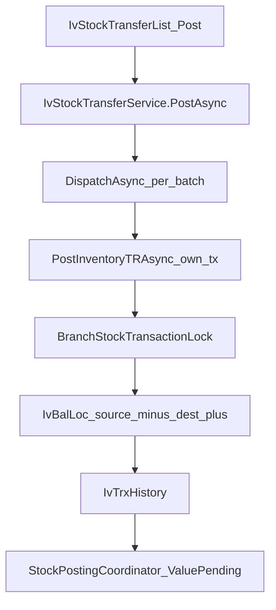
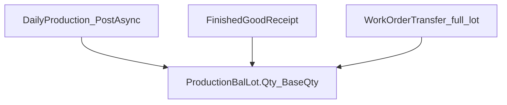

# Subcon Phase 0 — Current repository evidence

**Phase:** 0 (read-only forensic audit)  
**Date:** 2026-11-11  
**Costing class:** **A non-costing** — this Phase 0 wrote markdown under `plans/subcon/` only.  
**Attestation:** zero costing, quantity, CostLayer, valuation, ledger, posting, rollback, schema, menu, or DI changes in this phase. Feature flags untouched. `OpenPeriodBackdatedReplayEnabled` not enabled.

---

## 1. Pinned revision

| Item | Value |
|---|---|
| Branch | `productionv2` |
| HEAD | `1b2d70618ce44d5db0f13ea14d78697dbc27ea5f` |
| HEAD date / subject | 2026-11-11 11:14:03 +0800 — `Merge branch 'productionv2' of https://github.com/mokth/net10projectTemplate into productionv2` |
| v6 plan’s reviewed remote HEAD | `e24f54069316a346171fed7f14017c09d593cb95` (2026-11-07) |
| Commits after v6 pin | 16 (WAC/FIFO receipt replay, QA, sales price). Phase 0 re-traced live files; it did not copy the v6 file list as proof. |
| Uncommitted at audit start | `?? plans/productionv2_UNIFIED_SUBCON_UX_FIRST_GROK_4_6_PLAN_v6_DEEP_REVIEW.md` |
| Phase 0 writes | `plans/subcon/*.md` only |
| Build / SQL Server tests this phase | **NOT RUN** (read-only). SQLite/SQL Server execution is a later-phase gate. |
| Subcon code in Core/UI/Model | **None.** Grep hits are planning docs and BOM `ProcessType=SUBCONTRACT` metadata. |

**Skills loaded (read-only):** `.agents/skills/erp-ui-core/skill.md`, `production-transaction-ui/skill.md`, `inventory-transaction-ui/skill.md`, `productionv2-costing/SKILL.md` plus `references/stock-balance.md`, `inventory.md`, `production.md`, `procurement.md`, `replay-rollback.md`, `testing.md`, `repository-evidence.md`.

**Authority reminder:** `references/repository-evidence.md` is a 2026-10-30 GitHub sample, not this HEAD. Live files below supersede it.

---

## 2. Inventory source — UI → post → valuation → rollback

```text
IvStockTransferList.razor.cs ConfirmActionAsync (Post/Rollback on LIST only)
  → IvStockTransferService.PostAsync / RollbackAsync
       (IvStockTransferService.cs:611–624)
       delegates with NO local permission check
  → IIvInventoryPostingService.PostAsync / RollbackAsync
       (IvInventoryPostingService.DispatchAsync ~250–428)
       server CanAsync(MenuCodes.InventoryStockTransfer, Post|Rollback)
       foreach batchNos.Distinct() → private PostInventoryTRAsync / RollBackInventoryTRAsync
  → PostInventoryTRAsync (private, :3032–3522)
       own CreateDbContext + BeginTransaction (:3057–3058)
       BranchStockTransactionLock.AcquireAsync (:3059)
       BeginStandaloneLedgerAsync → coordinator.BeginInTransactionAsync
       lock IvBalLoc slices, mutate source/dest qty, StageNewTransferLot, AddHistory
       CompleteStandaloneLedgerAsync → ValuePendingAsync / seal CostLayer / WAC / Standard
       batch.BatchStatus = POSTED
       tx.CommitAsync (:3501–3502)
  → RollBackInventoryTRAsync (private, :3525–3808)
       own transaction + lock
       reverse BalLoc from history, ApplyHistoryRollback
       batch.BatchStatus = NEW (:3791)
       tx.CommitAsync
```

Detail page `IvStockTransfer.razor` is **Save/Update only**. Posting is list-driven, matching inventory-transaction-ui.

### 2.1 Public posting API — transfer has no in-transaction hook

Source: `ErpWeb.Core/Inventory/IIvInventoryPostingService.cs`.

| Public member | In-transaction (caller owns tx)? | Notes |
|---|---|---|
| `BeginPostingInTransactionAsync` | V2 ledger begin only | Default no-op on interface; implementation requires existing SQL tx |
| `CompletePostingInTransactionAsync` / `AbortPostingInTransactionAsync` | Yes (ledger) | Does not post TR physical stock |
| `ValuePostingInTransactionAsync` | Yes (valuation) | |
| `PostAsync(trxType, batchNos)` | **No** — dispatcher | Per-batch independent transactions |
| `RollbackAsync(trxType, batchNos)` | **No** | Same |
| `PostStockOutInTransactionAsync` + rollback | **Yes** | MI / scrap / VR |
| `PostStockInInTransactionAsync` + rollback | **Yes** | MR / CR / production-owned PRTN |
| `DeleteNewStockInBatchInTransactionAsync` | Yes | NEW CR/MR only |
| `PostStockAdjustmentInTransactionAsync` | **Yes** | ADJ |
| `PostStockCountAdjustmentInTransactionAsync` | Throws `NotSupportedException` on default | Count-owned ADJ |
| **`PostStockTransferInTransactionAsync`** | **DOES NOT EXIST** | Confirmed grep: only plan documents mention this name |

`StockPostingCoordinator.BeginInTransactionAsync` (`ErpWeb.Core/StockLedger/StockPostingCoordinator.cs:226–235`) **requires** `db.Database.CurrentTransaction`. TR uses it **inside** `PostInventoryTRAsync`’s private transaction via `BeginStandaloneLedgerAsync` (private, `IvInventoryPostingService.cs` ~135). A Subcon caller cannot wrap TR physical posting on its own `AppDbContext` without a new public hook.

### 2.2 Multi-batch is not all-or-none

`DispatchAsync` loops `foreach (var batchNo in batchNos.Distinct())` and, on mixed post success, rewrites the aggregate (`IvInventoryPostingService.cs` ~417–428):

```text
Posted {SucceededCount} of {results.Count}. Batch {n}: {error} ...
```

`IvInventoryPostingResult.FromBatches` (`IIvInventoryPostingService.cs` ~30–44) uses the same “Posted X of Y” wording. **One TR batch** is atomic (own tx). **Several batches in one PostAsync call** can partially succeed. A 20-line Subcon document must map to **one** underlying inventory batch, or be **independently posted documents**, never a silent multi-batch compose.

### 2.3 Lot rules (save and post)

`IvStockTransferService.ValidateLineAsync` (`ErpWeb.Core/Inventory/IvStockTransferService.cs`):

| Rule | Lines | Effect on Subcon |
|---|---|---|
| Lot-controlled: dest lot required | ~848–852 | |
| Dest lot **must differ** from source lot | ~854–857 | Cannot TR “back to original lot” |
| Dest lot **must not already exist** (unless unchanged edit) | ~870–882 | Return TR into the supplier’s existing dest lot is rejected |
| Duplicate dest lots in one batch | ~671–683 | |
| Non-lot: source and dest lot **must be empty** | ~885–901 | **Pilot candidate** |

Post-time existing-lot rejection is repeated in `PostInventoryTRAsync` (~3259–3266). Tests: `IvStockTransferPostingServiceTests.Save_rejects_destination_lot_equal_to_source_lot`, `Save_rejects_existing_destination_lot`, `Lot_split_post_creates_three_destination_lots`, `Partial_post_fails_when_third_destination_lot_exists` (batch stays NEW).

**Lot round-trip via ordinary TR: BLOCKED.** Rollback restores source qty and sets batch `NEW`; that is undo, not a second physical return.

### 2.4 Rollback lifecycle vs Subcon history

Inventory TR rollback sets `IvTrxBatch.BatchStatus = NEW`, increments `RollbackCount`, stamps `RollbackOperationId` (`IvInventoryPostingService.cs` ~3791–3797). History is reversed, not deleted.

Subcon must **not** reuse a generic `ROLLED_BACK` document status as the source batch state. Required split:

- Source operational state: `NEW` after eligible rollback (repost uses **new** posting generation / links).
- Subcon historical event: immutable `REVERSED` / voided posting generation.

Stale source batch IDs after rollback+repost would duplicate statement quantities.

### 2.5 Replay / period / future date

TR post/rollback consult `OpenPeriodBackdatedReplayEnabled` (`IvInventoryPostingService.cs` ~82–83, TR post ~3039–3055). If replay is required: try WAC/FIFO/Standard backdated TR helpers; else `UnsupportedHistoricalInventoryPost`. Period close: `IvPeriodCloseGuard.EnsureOpenAsync`. Future post: `FuturePostDateError`. Subcon must inherit these refusals; it must not invent a backdated path.

### 2.6 Permissions

| Layer | Menu | Permission |
|---|---|---|
| UI list | `MenuCodes.InventoryStockTransfer` = `INV_STOCK_TRANSFER` | `PermissionCodes.Post` / `Rollback` |
| Server dispatch | same | `CanAsync` in `DispatchAsync` (~288–306) |
| `IvStockTransferService.PostAsync` | none | Delegates blindly |

**Permission-composition (open Phase 1 design, not implemented):** posting from a Subcon screen must not bypass Inventory Transfer POST. Either require **both** Subcon POST and `INV_STOCK_TRANSFER` POST, or obtain a separate security-architecture approval. Do not add a privileged backend shortcut.

---

## 3. Production source — WIP authority and consumers

`ProductionBalLot` (`ErpWeb.Model/Entities/Production/ProductionBalLot.cs` 3–5, 17–24, 62):

> Qty/BaseQty are authoritative; movements are audit.

No `OffsiteQty`. Constraints `Qty >= 0`, `BaseQty >= 0` (`ProductionBalLotConfiguration`).

### 3.1 Work Order Transfer is the wrong API

`ProductionWorkOrderTransferService` class summary (line 15): *full-balance ownership transfers between compatible Work Orders.*

- Create snapshots entire `lot.Qty` / `BaseQty` / `TotalCost` (~800–801).
- Create request has **no partial qty** (`IProductionWorkOrderTransferService` create request ~83–89).
- Post moves full source and throws if `source.Lot.Qty != 0` after (~1054–1077).
- Test: `ProductionWorkOrderTransferServiceTests.Post_moves_the_full_verified_balance_and_records_the_transfer_genealogy_pair`.

Rollback patterns in `ProductionWorkOrderTransferService.Rollback.cs` (branch lock, fingerprint, `coordinator.BeginInTransactionAsync`, `IProductionStockWriter.ApplyAsync`) are **reusable as safety patterns**, not as Subcon business semantics.

### 3.2 Process handoff is internal next-step only

`ProductionProcessHandoff.cs` (lines 6–14): same-route-step handoff, `IssueMethod = "HANDOFF"`, `SupplySource = "PREVIOUS_PROCESS"`. Synthetic lot `OP:{producingOperationId}`. Daily Production consumes `handoffLot.BaseQty` (`ProductionOutputService.Posting.cs` ~143–171, 430–458). **No supplier / offsite custody.**

### 3.3 `ProcessType=SUBCONTRACT` is duration metadata only

`PrProcessTypes.Subcontract` (`ErpWeb.Model/Entities/Planning/PrBomOperation.cs` 119). `IsDurationBased` includes Subcontract (134–135). `SupportsMachine` excludes it (127–128). `WorkOrderReadinessValidator.cs` ~213–218 requires positive `StandardDurationMinutes` and ignores machines.

**Grep of `ErpWeb.Core/Production`:** no dispatch, receipt, supplier, or WIP split keyed off `SUBCONTRACT`. The new Subcon module must not pretend this process type already moves stock/WIP.

### 3.4 Quantity mutators (summary; full matrix in readiness file)

| Route | Mutates `ProductionBalLot.Qty`/`BaseQty`? | Partial qty? | Offsite split? |
|---|---|---|---|
| Daily Production consume/produce | **Yes, directly** (`ProductionOutputService.Posting.cs` ~364–366) — **not** via `IProductionStockWriter` | Yes (consumption) | **No** |
| FG receipt | Yes via `IProductionStockWriter.ApplyAsync` | Yes | **No** |
| Production stock return / PADJ | Yes via writer | Yes | **No** |
| WO Transfer | Yes via writer | **No — full lot** | **No** |
| QA logical hold | Reserves remaining vs hold; does **not** reduce eligibility sums in `AvailableQtyAsync` | Partial reservation | **No** |

`StockMovementRegistry` lists `STATUS_OUT` / `STATUS_IN` (`ErpWeb.Core/StockLedger/StockMovementRegistry.cs` 45–46). **No production poster currently uses them for partial custody.**

`IProductionStockWriter` comment “only V2 production quantity mutator” is **not exhaustive**: Daily Production updates lots in place.

---

## 4. WarehouseType and stock identity

`IvWarehouse.WarehouseType` (`ErpWeb.Model/Entities/Inventory/IvWarehouse.cs` 9) is a 20-char lookup, validated in `IvInventoryRefService` against `AdLookupTypes.WarehouseType`. Seeds include `GENERAL`. **No consumer query filters on `WarehouseType`.** Warehouse joins in inquiry are for descriptions (`IvStockCommonRepository` ~823–912).

Physical identity remains: company + branch + item + warehouse + location + lot + `IStatus` + UOM (`references/stock-balance.md`). A `SUBCON` warehouse **name/type does not hide stock** from Sales FIFO, DR reservation, MI picker, Production material issue, stock count, or transfer source picker.

`IvItemStatuses`: `ACTIVE`, `DAMAGED`, `QCHOLD` (`IvTrxConstants.cs` 84–90). FIFO sales and production material **require `ACTIVE`**. Generic `IvBalLocPicker` / `SearchOnHandPagedAsync` (`IvStockCommonRepository.cs` ~472) shows any status with `StdQty>0` (no `IStatus` filter, no `WarehouseType` filter).

---

## 5. QA (frozen / record-only)

`QaReadinessMessages.cs` 14–33 and `QaPolicyService.RejectNewEnablement` 184–211: **new enablement of all five posting gates is rejected**. Default policy: all gates false (`DefaultPolicy` 153–164).

| Gate | Enable new? | If somehow already on |
|---|---|---|
| Incoming inspection | Frozen | `QaReceiptAuthorizationService.ClaimGoodsReceiptAsync` returns `IncomingFrozen` |
| FG inspection | Frozen | `FinalFgFrozen` |
| Logical (WIP lot) hold | Frozen | Implementation exists; gate off |
| Physical warehouse hold | Frozen | Qty reservation on `IvBalLoc`; does **not** set `IStatus=QCHOLD` |
| Non-good Daily Production | Frozen | Record-only |

Uninstalled QA: posting continues without a quality gate (`QaReadinessMessages.NotInstalled`). A QA **case** is not a physical hold.

---

## 6. Procurement service PO

Classification **exists**:

```csharp
PoOrderCalc.IsServiceIType(iType) => IType == "SERVICE"   // PoOrderCalc.cs:107–108
PoOrderService.IsServiceLine(...) uses that rule           // ~2631–2634
```

Service lines are excluded from remaining-balance / force-close stock tests (`PoOrderCalc.HasRemainingBalance`). Vendor return on service line is blocked (`IvInventoryPostingService` ~4628–4630).

**Settlement is not proven as Subcon-ready:**

- `PoInvoiceService` (~1633–1636): *cannot invoice before goods receipt (net received is zero)*.
- Service classification does **not** create a GRN-free invoice path.
- Non-stock goods receive (`IvTrxTypes.NonStockGoodsReceive`) exists for one-time/indirect lines — **end-to-end Subcon fee billing (HR/JOB vs physical PCS) was not executed this phase**.
- No special HR/JOB/LOT UOM conversion in `PoOrderCalc`; PO uses item purchase UOM.
- Approval: `IProcurementApprovalGuard` on PO save/cancel/close. Subcon must not bypass it.

---

## 7. Menus, numbering, DI (for later phases)

| Concern | Current pattern |
|---|---|
| Menu tree | `ErpWeb/Menus/menus.xml` — Purchase SortOrder 4, Planning 5, Quality 6, Security 7 |
| Quality analog | Parent `QUALITY` + flat `QA_WORKBENCH` / `QA_INQUIRY` / `QA_SETTINGS` (`MenuCodes.cs` 291–295). Comment: record-only; no POST on parent. |
| Permissions | `PermissionCodes`: Access, Add, Edit, Delete, Print, Post, Rollback, Export, ViewCost, Approve, … (`PermissionCodes.cs` 5–64). Must stay in `All`. |
| Numbering | `RunningNumberKeys` (`ErpWeb.Core/Numbering/RunningNumberKeys.cs`). No Subcon key. Inventory txs share `IV_BATCH`. QA uses `QA_CASE`. |
| DI | `ErpWeb.Core/CoreServiceCollectionExtensions.cs` — e.g. `AddScoped<IIvStockTransferService, IvStockTransferService>()` line 214; QA services ~306–312. |
| DbContext | `AppDbContext` has `IvTrxBatches`, `ProductionBalLots`; **no Subcon DbSets**. |

---

## 8. Tests inspected (not executed)

| Suite | What it proves for Subcon |
|---|---|
| `ErpWeb.Tests/Inventory/Transaction/IvStockTransferPostingServiceTests.cs` | Lot split, same/existing dest lot rejection, intra-batch atomicity, rollback restores source, POSTED→NEW→repost |
| `ErpWeb.Tests/Inventory/Transaction/IvStockTransferLedgerAuthorityTests.cs` | FIFO/WAC/Standard TR + rollback, QA dest hold, backdated replay when flag on |
| `ErpWeb.Tests/Production/Transaction/ProductionWorkOrderTransferServiceTests.cs` | Full-balance WO transfer only |
| `ErpWeb.Tests/Production/Transaction/ProductionProcessHandoffServiceTests.cs` | Partial **internal** handoff, not offsite |
| QA / PO invoice tests | Gate frozen enablement; invoice vs net received — not re-run here |

**Later-phase required (not this Phase 0):** SQL Server concurrency for last-qty dispatch, competing receipts, Post vs Rollback, session cleanup. SQLite cannot certify that (`references/testing.md`).

---

## 9. Source-to-valuation graphs

### Inventory TR (non-lot same-item — theoretical Subcon use)



Net company-owned qty for the item is preserved **if** source and dest are both company warehouses in the same costing identity. Valuation layers **move** with the transfer (FIFO layer ownership / WAC slice / Standard). That is a **valuation effect without editing costing code** — every future Subcon test must snapshot qty **and** value / layers before/after/rollback.

### Production WIP (no Subcon adapter exists)



There is no offsite node. Any unread Subcon flag would leave Daily Production / FG / PADJ / WOT free to consume the dispatched qty.

---

## 10. Costing / protected files — Phase 0 status

| Path | Touched this phase? |
|---|---|
| `ErpWeb.Core/StockLedger/Costing/**` | **No** |
| `StockReplay*` | **No** |
| `IvInventoryPostingService*.cs` | **Read only** |
| Production cost / output / FG posting | **Read only** |
| Period close | **Read only** |
| Schema / migrations | **No** |

**Phase 0 decision pack:** `VERIFIED` as a source-code audit at the pinned HEAD; **NOT VERIFIED** as a SQL Server / live-DB proof. Implementation of adapters is **BLOCKED** (see readiness matrix).

**STOPPED — awaiting explicit next-phase approval.**
